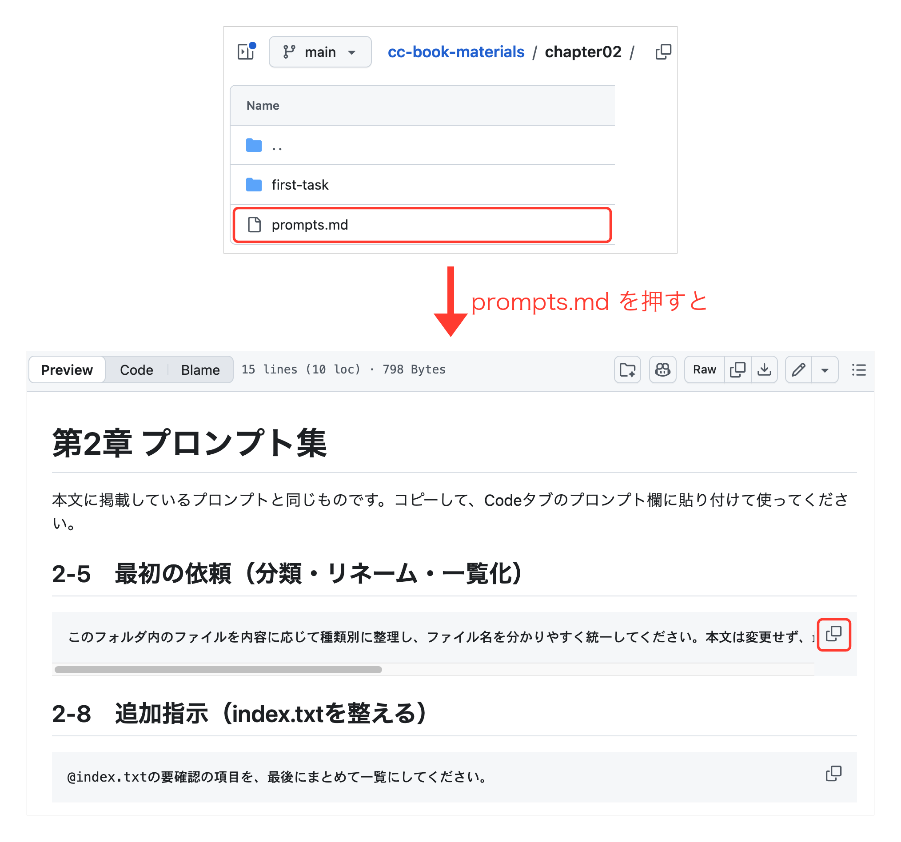

# 本書の練習用教材

『ゼロからわかる Claude Code 業務エージェントの教科書』の各章で使う練習用の教材ファイルをまとめたリポジトリです。

## はじめての方へ

1. このページの緑色の「Code」ボタンから「Download ZIP」を選んでダウンロードし、展開します。詳しい手順は本書の2.3節で説明しています。Windowsの「すべて展開」では、`cc-book-materials-main` の中にもう1つ同じ名前のフォルダができることがあります。そのときは、中のフォルダが教材フォルダです。
2. 章が指定するフォルダを、Claude Codeに渡します。どのフォルダを渡すかは、下の「フォルダ構成」にも書いてあります。渡し方は本書の2.4節で説明しています。
3. **本文のプロンプトは、この教材ページからコピーできるので、手で打ち込む必要はありません。** ページ上部のファイル一覧で、章のフォルダ（`chapter02` など）、`prompts.md` の順にクリックすると、プロンプトが枠で表示されます。枠の右上にあるコピーボタン（下の画像の赤枠）を押し、Claude Codeの入力欄に貼り付けてください。

## フォルダ構成

章ごとにフォルダが分かれています。各章のフォルダには、本文のプロンプトをコピーして使える `prompts.md` と、Claude Codeに渡す練習用フォルダが入っています。

フォルダ名や `prompts.md` の見出しにある「8-1」のような番号は、本書の節番号（8.1節など）に当たります。

- `chapter02/` — 第2章 Claude Codeに最初の仕事を任せる
  - `prompts.md` — 本文のプロンプト集
  - `first-task/` — ファイル整理の練習用フォルダ（Claude Codeにはこのフォルダを渡す）
- `chapter03/` — 第3章 過去資料からレポートを作る
  - `prompts.md` — 本文のプロンプト集
  - `practice/` — 過去資料からレポートを作る練習用フォルダ（Claude Codeにはこのフォルダを渡す。過去資料は `practice/work-docs/` に入っています）
- `chapter04/` — 第4章 作業場所をVS Codeに移す
  - `prompts.md` — 本文のプロンプト集
  - `terms-review/` — 英文規約の読み解きとチェックリスト照合の練習用フォルダ（Claude Codeにはこのフォルダを渡す）
  - `sample-output/` — 完成イメージのサンプル（渡すフォルダの外にあるので、見比べたいときにブラウザで開く）
- `chapter05/` — 第5章 繰り返す仕事をSkillにする
  - `prompts.md` — 本文のプロンプト集
  - `meeting-notes/` — 会議メモから議事録Skillを作る練習用フォルダ（Claude Codeにはこのフォルダを渡す）
- `chapter06/` — 第6章 コネクタで外部サービスとつなぐ
  - `prompts.md` — 本文のプロンプト集
  - `connector-practice/` — コネクタで議事録を作る練習用フォルダ（Claude Codeにはこのフォルダを渡す）
- `chapter07/` — 第7章 サブエージェントに見てもらう
  - `prompts.md` — 本文のプロンプト集
  - `subagent-practice/` — サブエージェントでレビューと改善ループを試す練習用フォルダ（Claude Codeにはこのフォルダを渡す）
- `chapter08/` — 第8章 スマホから頼みURLで確かめる
  - `prompts.md` — 本文のプロンプト集
  - `8-1-survey/` — アンケートのダッシュボードを作る練習用フォルダ（Claude Codeにはこのフォルダを渡す。8.2節のアーティファクトも、このフォルダで作った `dashboard.html` をそのまま使います）
- `chapter09/` — 第9章 作らせる前に要望を固める
  - `prompts.md` — 本文のプロンプト集
  - `9-1-brand-slides/` — 見本画像に合わせてスライドを作る練習用フォルダ（Claude Codeにはこのフォルダを渡す）
  - `9-2-design-samples/` — フォント・配色の候補選び用の空フォルダ（Claude Codeにはこのフォルダを渡す。読ませるファイルはなく、候補をまとめる `design-picker.html` の置き場です）
  - `9-3-expense-check/` — 経費精算規程の抜粋から申請前のチェックツールを作る練習用フォルダ（Claude Codeにはこのフォルダを渡す。選択肢付きの質問とプランモードで要件を決めてから作ります）
- `chapter10/` — 第10章 定期実行と会話履歴で育てる
  - `prompts.md` — 本文のプロンプト集
  - `10-1-daily-news/` — 定期実行でニュースを溜める空フォルダ（Claude Codeにはこのフォルダを渡す。読ませるファイルはなく、`daily-news.md` と `today.html` の置き場です。10.2節の会話履歴も同じフォルダで進めます）

## 使い方の注意

- 章が指定するフォルダだけをClaude Codeに渡して使ってください。`prompts.md` は渡すフォルダの外に置いてあるので、整理や分析の対象に混ざることはありません
- 第4章にある `sample-output/` は完成イメージのサンプルです。自分の結果と見比べる用で、課題の入力には使いません
- 教材の内容（会社名、人名、数値など）はすべて架空のものです
- 練習中にファイルが壊れたり消えたりしても、このZIPを展開し直せば元に戻せます
